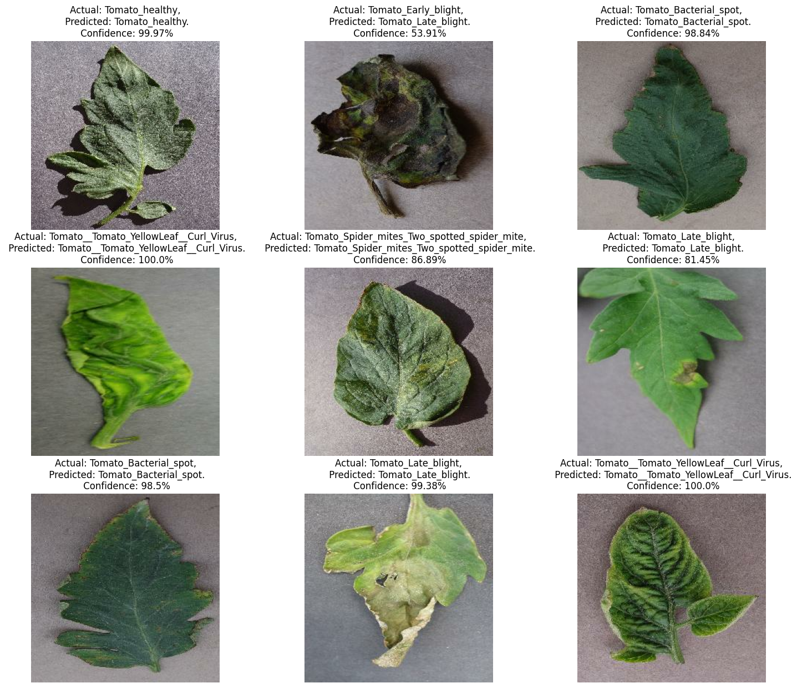
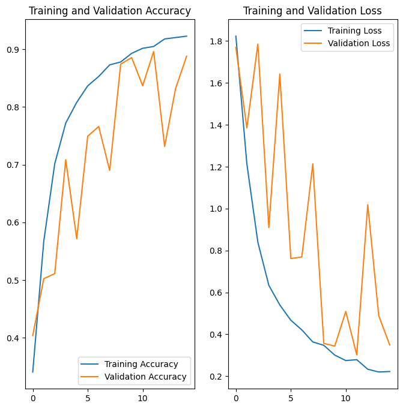

# 🍅 Tomato Disease Identification with Deep Learning


A convolutional neural network (CNN) that classifies tomato leaf images into **9 diseases + healthy** (10 classes), trained on the public PlantVillage dataset. The goal is fast, low-cost disease screening from a single leaf photo, as a first step towards a field-ready diagnostic tool.



## Results

| Metric | Value |
|---|---|
| Images | 16,011 (10 classes) |
| Split | 80% train · 10% validation · 10% test |
| Training accuracy (epoch 15) | 92.2% |
| **Validation accuracy (epoch 15)** | **88.8%** |
| Model size | 184k parameters (≈720 KB) |



Validation accuracy oscillates between epochs (see curves), which suggests the learning rate is high for this architecture and that callbacks such as early stopping would help. See *Next steps*.

## Method

1. **Data loading** with `tf.keras.preprocessing.image_dataset_from_directory` (256×256 RGB, batch size 32).
2. **Pipeline:** cache → shuffle → prefetch for efficient training.
3. **Preprocessing layers inside the model:** resizing + rescaling (1/255), so the exported model accepts raw images.
4. **Data augmentation:** random horizontal/vertical flips and rotations (±20%).
5. **Architecture:** 6 × [Conv2D (32→64 filters, 3×3, ReLU) + MaxPooling] → Flatten → Dense(64) → Dense(10, softmax).
6. **Training:** Adam optimizer, sparse categorical cross-entropy, 15 epochs.
7. **Export:** the trained model is saved in TensorFlow SavedModel format in `model/1/`, ready to be served (e.g. TensorFlow Serving or a FastAPI app).

## Classes

Bacterial spot · Early blight · Late blight · Leaf mold · Septoria leaf spot · Spider mites (two-spotted) · Target spot · Yellow leaf curl virus · Mosaic virus · Healthy

## Repository structure

```text
DiseaseIdentification/
├── Training/
│   └── TomatoDiseaseIdentification.ipynb   # full training notebook
├── model/
│   └── 1/                                  # exported SavedModel
├── images/                                 # figures used in this README
├── LICENSE
└── README.md
```

## How to reproduce

1. Download the PlantVillage dataset (tomato classes) from [Kaggle](https://www.kaggle.com/datasets/arjuntejaswi/plant-village) and place the 10 `Tomato_*` folders in `Training/PlantVillage/`.
2. Install the dependencies:
   ```bash
   pip install tensorflow matplotlib numpy jupyter
   ```
3. Open and run `Training/TomatoDiseaseIdentification.ipynb`.

## Next steps

- Report the held-out **test accuracy** and a **per-class confusion matrix**.
- Add `EarlyStopping` / `ReduceLROnPlateau` callbacks to stabilize validation accuracy.
- Compare with **transfer learning** (e.g. MobileNetV2, EfficientNet), which usually reaches >95% on PlantVillage.
- Evaluate on **field photos**: PlantVillage images are taken on a uniform background, so real-world accuracy is expected to be lower.
- Deploy as a small web app (FastAPI or Streamlit) for photo upload.

## Data and credits

- Dataset: Hughes, D. P., & Salathé, M. (2015). *An open access repository of images on plant health to enable the development of mobile disease diagnostics.* [arXiv:1511.08060](https://arxiv.org/abs/1511.08060)
- Author: **Ricardo Antonio Ruiz-Cardozo**: Agricultural Engineer, MSc in Genetics and Plant Breeding, PhD candidate in Statistics and Agricultural Experimentation (ESALQ/USP).

Code released under the [MIT License](LICENSE). The dataset keeps its original license.
